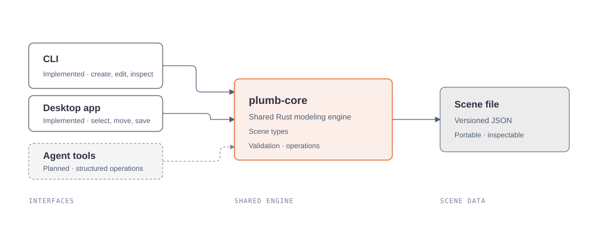

# Plumb

Plumb is an open-source, Rust-first 3D modeling environment built around a shared scene engine.
The engine exposes explicit operations that desktop tools, command-line workflows, scripts, and agent interfaces can share.



## What works today

The `plumb-core` crate provides versioned scene data, stable object IDs, box creation, position changes, validation, and JSON serialization.
The `plumb-cli` application creates and edits scene files and prints their contents as JSON.

The desktop app is an early read-only scene viewer.
It loads and validates Plumb JSON through `plumb-core` and displays boxes in an orbitable 3D viewport.
Editing and agent protocols are still planned.

## Build

Install a stable Rust toolchain and the platform dependencies described in the desktop section, then run:

```sh
cargo build --workspace
cargo test --workspace
```

## Desktop app

Install Node.js and npm, Rust, and the platform dependencies required by [Tauri](https://v2.tauri.app/start/prerequisites/).
On Debian or Ubuntu, install the Linux dependencies with:

```sh
sudo apt update
sudo apt install pkg-config libwebkit2gtk-4.1-dev build-essential curl wget file libxdo-dev libssl-dev libayatana-appindicator3-dev librsvg2-dev
```

Then start the desktop development app:

```sh
cd apps/plumb-desktop
npm install
npm run tauri dev
```

The window opens centered at 1100 × 700 logical pixels and keeps within the available work area.
Choose **Open example scene** to see a sample, or **Open scene** to load a local `.json` scene file.
Orbit with left-drag, zoom with the scroll wheel, and pan with right-drag.

## CLI example

```sh
cargo run -p plumb-cli -- new scene.json
cargo run -p plumb-cli -- add-box scene.json block 2 3 4
cargo run -p plumb-cli -- move scene.json 1 1 0 0
cargo run -p plumb-cli -- inspect scene.json
```

Scene dimensions and positions use scene units.
CLI diagnostics are written to standard error, while inspection output is JSON on standard output.

## Workspace

- `crates/plumb-core/` contains scene types, validation, modeling operations, and serialization.
- `apps/plumb-cli/` exposes the core operations in a scriptable command-line interface.

## Development

Run `cargo fmt --all`, `cargo check --workspace`, and `cargo test --workspace` before proposing changes.
Keep scene semantics in `plumb-core` so additional interfaces can reuse the same behavior.

## Continuous integration and releases

GitHub Actions checks pull requests and pushes to `master` with Rust formatting, workspace checks, workspace tests, and a production desktop frontend build.
The checks use the committed npm lockfile and stable Rust.

Pushing a version tag such as `v0.1.0` builds desktop installers and opens a draft GitHub release for review.
The initial release targets are Linux x86_64, Windows x86_64, and macOS arm64.
After reviewing the generated installers and release notes, a repository maintainer can publish the draft release.
